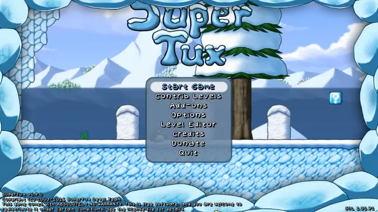

# GlyphShift

> Give your games a character of their own.

GlyphShift redraws a running game, live, as art made of type. Every frame
becomes characters, blocks and pen strokes, each chosen for the shape it has
to draw, in ink and paper colors you direct from an editor on top of the game.
Press one key over a game that is already running; nothing is installed into
it, and each game keeps its own style.



*Native SuperTux running on its own; the capture overlay is attached to its
window and switches styles live (Comic, Newsprint, Blueprint). Recorded with
`tools/record_demo.py`.*

## Why it is not another ASCII filter

ASCII effects usually come in two kinds: post-processing shaders loaded into
the game, such as the ASCII effect of shader collections for
[ReShade](https://reshade.me/), and converters that turn images or video into
text. GlyphShift takes neither route.

| | ASCII shaders loaded into the game (ReShade and similar) | GlyphShift |
| --- | --- | --- |
| How it reaches the game | A DLL placed next to the game hooks its graphics API inside the game's process. | **Capture overlay:** reads the finished window like a screen recorder (Windows.Graphics.Capture, X Composite) and draws in its own click-through window. Nothing is loaded into the game. |
| Graphics APIs | One hook per API, set up per game. | Independent of the game's API: whatever the desktop composes is captured the same way (tested so far with OpenGL, Vulkan, Direct3D 12, and DXVK under Proton). |
| Attaching | Installed before the game starts. | A hotkey over a game that is already running; another press detaches it. |
| Characters | A short built-in brightness ramp. | Real glyphs rasterized from any installed TTF/OTF font: ASCII, blocks, Braille or up to 256 Unicode characters of your choice, each kept at its typographic place. |
| Which character goes where | By brightness. | By shape: each cell's 4×4 light/dark layout is matched against the font's glyphs, and real outlines become `/ \ \| _ -` strokes, so silhouettes survive. |
| Color | Usually monochrome or the scene's color. | Art direction: scene-colored ink on dark or light paper, a watercolor wash, glow and ink bleed, nine ready styles. |
| Motion | Glyphs flicker as noise and light change. | Temporal stability keeps a cell's glyph while it still fits; an optional grid anchored to the world travels with a scrolling camera. |
| Editing | Configuration files or the injected menu. | An editor over the game (Insert), saved per game; F10 compares with the original. |

Because the game never runs GlyphShift's code, it does not depend on the
game's renderer, survives game updates, and leaves the game untouched when you
detach. The cost of capturing is about one display refresh of latency
(measured on Linux); on Linux, launching through `glyphshift` instead renders
inside the game for the lowest latency.

## Where it runs

| Platform | Mode | Status |
| --- | --- | --- |
| Linux, X11 | Capture overlay with hotkey, tray icon and per-game styles | Working; tested on native SuperTux and on Windows SuperTux through Proton |
| Linux, X11 | Launcher rendering inside OpenGL and Vulkan games (lowest latency) | Working; tested on native fixtures, glxgears, vkcube, SuperTux, and SuperTux through Proton/DXVK |
| Windows 11 | Capture overlay with hotkey, notification-area icon and per-game styles | In progress, working: tested on SuperTux 0.7.0 and on ELDEN RING (Direct3D 12, offline) |
| Linux, Wayland | Capture overlay | Planned |
| macOS | Capture overlay | Possible later |

Games must run windowed or borderless; exclusive fullscreen and HDR are not
supported. GlyphShift is made for offline and single-player play: it does not
modify games, and online play is outside what it is designed and tested for.
Verified hardware so far is NVIDIA; see [Compatibility](#compatibility).


*The default illustrated preset applied by the GPU shader to a captured SuperTux
frame: scene-colored ink, outline characters for silhouettes and a soft paper
wash. The [live editor capture](docs/shape-live-editor.png) shows an earlier
version of the effect running in the game through Proton.*

## Make it your own

- **Two rendering styles:** classic luminance-based glyphs, or illustrated
  rendering with separate surface fill and directional contours.
- **Local shape matching:** select glyphs by the light/dark arrangement inside
  a cell to retain small silhouettes, with scene-colored paper to avoid black gaps.
  Add outline characters such as `/\|_()^` to draw edges with text, used only
  where they actually fit the scene.
- **Ink, paper and light:** scene-colored ink that glows on dark paper or
  prints dark on light paper, adjustable saturation, a smooth watercolor paper
  wash and a phosphor glow / ink bleed.
- **Line art that follows the game:** pixel-level contour tracing turns real
  outlines into `| - / \` strokes and ignores gradients and fine texture.
- **Pixel-crisp glyphs:** optional binary glyph masks and solid outline
  strokes, so characters read like pixel art instead of blurred text.
- **Calm in motion:** temporal stability keeps each cell's glyph while it still
  fits, so noise and flickering light do not make the drawing boil, and an
  optional world-anchored grid follows the camera in scrolling games, so the
  glyphs travel with the scene instead of crawling across the screen.
- **Your characters and fonts:** ASCII, alphanumeric, binary, blocks, Braille,
  or up to 256 custom Unicode characters, with local TTF/OTF fonts. Characters
  keep their typographic position (`_` on the floor, `'` at the top) and an
  adjustable stroke weight.
- **Live art direction:** independent cell dimensions, source color or
  monochrome, ink and paper colors, exposure, contrast, gamma and contour controls.
- **Automatic exposure:** follows the scene's brightness, lifting dark games
  toward a readable mid tone and easing in over a moment when the scene changes.
- **Adjustable intensity:** blend scene detail with glyphs or use strength 1
  for a drawing composed entirely of glyphs.
- **Per-game presets:** name, save and switch styles from the overlay.
- **OpenGL and Vulkan:** GPU rendering with the same controls on both backends,
  including the tested offline Proton/DXVK setup.

| Original frame | Ink on paper |
| --- | --- |
|  |  |

These are comparisons of the same captured frame using the actual GPU renderer.
More styles: [classic ASCII](docs/illustration-classic.png),
[illustrated color](docs/shape-color.png),
[coarser blocks](docs/illustration-blocks.png).

## Build from source

GlyphShift currently targets **Linux x86-64 with an X11 desktop**, windowed or
borderless applications, and an OpenGL 3.3 / Vulkan 1.0 capable driver.
It is under active development; compatibility is verified for specific
applications rather than all Linux games.

You need a C++20 compiler with floating-point `std::from_chars`, CMake 3.20+,
Ninja, Python 3, Git, Xlib, OpenGL/GLX and Vulkan development files,
`glslangValidator`, FreeType, Fontconfig, pkg-config, libxcb, xcb-keysyms, and
the X Composite, Damage, Fixes and Xft libraries.
Install a monospace font or supply a local font for text character sets.

On Arch Linux:

```bash
sudo pacman -S --needed base-devel cmake ninja python git libx11 libglvnd \
  vulkan-headers vulkan-icd-loader glslang freetype2 fontconfig pkgconf \
  ttf-dejavu libxcb xcb-util-keysyms libxcomposite libxdamage libxfixes libxft
```

Install the Vulkan driver matching your GPU as well. From the repository root:

```bash
cmake --preset dev
cmake --build --preset dev
```

For an optimized build, use `cmake --preset release` followed by
`cmake --build --preset release`; executables will be in `build/release`.
Builds use the vendored Dear ImGui sources and do not download dependencies.

**Windows (in progress).** The capture overlay works on Windows 11 and is
still being validated; there is no installer yet. You need Visual Studio 2022 with
C++ (MSVC and the Windows SDK), CMake 3.20+, Python 3, Git, the
[Vulkan SDK](https://vulkan.lunarg.com/) and FreeType from
[vcpkg](https://vcpkg.io/) (`vcpkg install freetype:x64-windows`, with
`VCPKG_ROOT` set). From a *Developer PowerShell for VS 2022*:

```powershell
cmake --preset windows-dev
cmake --build --preset windows-dev
ctest --preset windows-dev
```

The Windows overlay works like the Linux one: run
`build\windows-release\glyphshift-overlay` (optionally `--preset art-comic`;
use the `windows-release` preset for an optimized build), switch to the game,
windowed or borderless, and press **Ctrl+Alt+G** to attach or detach; Insert
opens the editor and F10 toggles the effect. Its notification-area icon
detaches games, picks the style for the next attachment, turns start at
sign-in on or off and quits; `--autostart on` does the same from the command
line.

To install for your user, with a menu entry and icon:

```bash
cmake --install build/release --prefix ~/.local
```

This puts `glyphshift` and `glyphshift-overlay` in `~/.local/bin` (their files
stay together in `~/.local/lib/glyphshift`) and **GlyphShift** in your
application menu. Use a prefix without spaces or colons if you want the
launcher too; the overlay works from any prefix.

## Try the effect

Start with the included OpenGL demo, without needing a game:

```bash
GLYPHSHIFT_CONFIG="$PWD/presets/illustrated.conf" \
  ./build/dev/glyphshift -- ./build/dev/glyphshift-glx-fixture
```

For the Vulkan demo, replace `glyphshift-glx-fixture` with
`glyphshift-vulkan-fixture`. Launch a native offline game the same way:

```bash
GLYPHSHIFT_CONFIG="$PWD/presets/illustrated.conf" \
  ./build/dev/glyphshift --profile my-game -- /path/to/game
```

Replace `/path/to/game` with its executable. Run as a regular user, without
`sudo`. Inheritable-only capabilities that some desktop sessions grant are
cleared automatically; a process with real (effective or permitted)
capabilities is refused, as described in the
[test guide](tests/README.md#refusing-to-launch-from-a-process-with-capabilities).
That guide also contains the complete **offline SuperTux/GE-Proton command**
for the prepared local test environment; Steam is not required for that test.

| Key | Action |
| --- | --- |
| Insert | Open or close the in-game editor. |
| F10 | Toggle the effect and compare with the original scene. |
| Escape | Close the editor and return input to the application. |

The color and ink presets start with **6×10 cells and glyph strength 1** to
retain smaller objects. Try **8×12** for larger, more recognizable characters.
Open **Illustration** to adjust fill, contours and tone. Larger cells make individual
characters easier to recognize; 4×4 cells cannot preserve every letter's shape.
Use **Characters and font** to change the fill set, then **Apply characters**.
Use **Save preset** to retain your applied settings.

## Overlay mode

Start the game normally, from Steam or anywhere, and put GlyphShift on top of
its window instead of launching the game through it. The overlay reads the
window's image on the GPU and draws the effect in its own click-through window;
nothing is injected into the game. This section describes Linux (X11); the
Windows overlay works the same way, see [Build from source](#build-from-source).

```bash
./build/dev/glyphshift-overlay --preset art-comic
```

Leave it running, switch to the game and press **Ctrl+Alt+G** to attach
GlyphShift to the focused window; press it again to detach. It works with any
number of games, and each overlay ends when its game closes. Use
`--hotkey super+shift+F9` (any of `ctrl`, `shift`, `alt`, `super` plus a key) if
the combination is taken. Stop it with Ctrl+C; attached overlays end with it.

After installing, you can also start **GlyphShift** from your application
menu: it runs in the background and, when your desktop shows notifications,
tells you which key to press. Only one runs per display; starting it again
just reminds you that it is already running. To start it automatically when
you log in (with the same options, if you add them):

```bash
glyphshift-overlay --autostart on          # or: --autostart off
```

This uses the standard `~/.config/autostart` entry, which GNOME, KDE, Xfce and
similar desktops run; with i3, start a runner such as `dex --autostart` in
your configuration.

While running, GlyphShift shows its icon in the system tray. Click it to
detach a game, choose the style for the next games you attach, turn start at
login on or off, or quit. With polybar, enable its tray by adding a module:

```ini
[module/tray]
type = internal/tray
```

and listing `tray` in your bar's `modules-right`.

| Key | Action |
| --- | --- |
| Ctrl+Alt+G | Attach to or detach from the focused game. |
| Insert | Open or close the editor (game focused). |
| F10 | Toggle the effect and compare with the original scene. |

Saved presets are kept per game. To attach to one window without the
background hotkey, pass its ID:
`./build/dev/glyphshift-overlay --window "$(xdotool search --name "Game title")"`.
The overlay adds about one display refresh of latency (measured about 3 ms
on a 255 Hz monitor; up to about 17 ms at 60 Hz) and costs about the same GPU
time as the injected effect; launching through `glyphshift` (above) remains
the lowest-latency option. It was tested on native SuperTux and on Windows
SuperTux through Proton, attached with the hotkey.

## Choose a starting style

Try the [ready-to-use style collection](presets/README.md): Comic, Sepia,
Newsprint, Chalk, Ink & Edges, Blueprint, Midnight, CRT and Digital rain. Each
one redraws the whole scene in glyphs; the gallery compares them and explains
how to switch them live without restarting.
They are available directly under **Insert → Preset → Included styles**. Choose
one to apply it immediately; personal presets remain under **Saved presets**.
No config-file copying is needed. Restart through the rebuilt launcher once to
load this version of the overlay.

Change the `GLYPHSHIFT_CONFIG` path in the launch command:

| Preset | Look |
| --- | --- |
| [illustrated.conf](presets/illustrated.conf) | Scene-colored ink drawing with outline characters on a watercolor paper wash; 6×10. |
| [illustrated-blocks.conf](presets/illustrated-blocks.conf) | Coarser text and blocks; 10×14. |
| [illustrated-ink.conf](presets/illustrated-ink.conf) | Sparse dark ink on warm paper, with local silhouette matching; 6×10. |
| [readable.conf](presets/readable.conf) | Editable classic renderer preset for experimenting with scene/glyph blending. |
| [classic.conf](presets/classic.conf) | Pure monochrome with the original glyph ramp. |

Illustrated rendering is opt-in. Launching without an illustrated config keeps
the classic renderer unless a saved preset selects otherwise.
You can also enable **Illustration → Illustrated rendering** in the editor;
this preserves the other current settings.

To customize a file without changing a tracked preset:

```bash
cp presets/illustrated.conf /tmp/glyphshift-my-style.conf
GLYPHSHIFT_CONFIG=/tmp/glyphshift-my-style.conf \
  ./build/dev/glyphshift -- ./build/dev/glyphshift-glx-fixture
```

Edit and save that file to apply changes live. The editor never overwrites it.
Named presets are stored under
`$XDG_CONFIG_HOME/glyphshift/profiles/PROFILE/`, or
`~/.config/glyphshift/profiles/PROFILE/` by default. A config supplied through
`GLYPHSHIFT_CONFIG` takes precedence at startup and whenever that file changes;
unset it when testing restoration of a saved preset. Use `--profile` to keep
styles separate for games sharing a runtime such as Proton.

## Compatibility

GlyphShift affects only the application launched through it and its children.
The launcher enables the GLX module and Vulkan layer for that run, without a
system-wide installation. Keep the executable, shared libraries and `layers/`
directory together in the build tree.

SDL2/SDL3 OpenGL games are covered through their presentation calls, including
the SDL 2D renderer; native SuperTux 0.7.0 renders the effect with both its
`sdl` and `opengl` video modes. Verified applications include the native GLX/Vulkan fixtures, glxgears,
vkcube, and offline SuperTux 0.7.0 for Windows through GE-Proton/DXVK, including
the editor in those tested setups. Hardware validation used NVIDIA on X11;
Mesa llvmpipe GLX was also tested. AMD/Intel hardware, Mesa Vulkan and arbitrary
Proton games are not established by those results.

Native Wayland input, EGL, Steam integration, exclusive fullscreen and HDR are
not currently supported. The Windows capture overlay is in progress (working
on SuperTux and ELDEN RING, offline, on NVIDIA), before Wayland; see the
[roadmap](docs/implementation/README.md#roadmap). The tool is intended for **offline games and local
graphics applications**. Online play is outside its scope, and GlyphShift
never works around anti-cheat: the capture overlay does not touch the game
process at all (ELDEN RING, which ships with anti-cheat, was tested offline
that way), while the Linux launcher, which renders inside the game, is meant
only for games without anti-cheat.
The launcher refuses privileged processes and targets. Full glyph rendering
can lose fine HUD/text detail. Temporal stability calms flicker from noise and
lighting. The world-anchored grid follows one dominant camera translation:
parallax layers, a static HUD and 3D camera motion still change glyphs.

## Architecture: built to be multi-platform

GlyphShift runs on Linux with X11 and, in progress, on Windows, and it is
designed to stay independent of the operating system, the window system and the GPU API. These are three
separate layers, each with its own implementations:

| Layer | Today | Planned |
| --- | --- | --- |
| Platform (operating system) | Linux, Windows (in progress) | later macOS |
| Window system (capture, overlay, input) | X11, Win32 (in progress) | Wayland, Cocoa |
| Renderer (GPU API) | OpenGL, Vulkan | reused through interop where possible |

The art itself (settings, presets, characters, the glyph pipeline design and
the editor) lives in a portable core that knows none of them. X11 and Wayland
are window systems, not renderers: the same OpenGL or Vulkan pipeline serves
both. The capture overlay is the mode meant for every platform; injected
rendering through the launcher stays a Linux feature. The Linux- and
X11-specific code has been moved out of the shared modules into its own
layers, ready for Wayland and Windows work. See
[Platform architecture](docs/implementation/README.md#platform-architecture)
for the layers, dependency rules and migration plan.

## Development and documentation

- [Test guide](tests/README.md): manual demos, offline SuperTux, troubleshooting
  and automated graphics tests. `python3 tests/smoke/test_env.py setup` prepares
  the game and validation-layer test environment once, outside `/tmp`.
- [Implementation and TODOs](docs/implementation/README.md): architecture,
  remaining work, milestone acceptance criteria and recorded validation results.
- [Repository instructions](AGENTS.md): guidance for implementation agents.

Run the CPU and integration checks that do not require a display with:

```bash
ctest --preset dev
```

For development tooling, `cmake --preset dev` generates
`build/dev/compile_commands.json` and a root symlink for your LSP. Formatting
inherits Google style with four-space indentation and a 100-column limit.
Install `clang-format`, then activate the pre-commit check:

```bash
git config --local core.hooksPath .githooks
python3 tools/format.py --check
```

Use `python3 tools/format.py --apply` to format project C/C++ files. Vendored
sources are excluded. Before proposing a change, consult the implementation
reference for the relevant scope and validation requirements.

## License

GlyphShift is released under the [MIT License](LICENSE). It includes
[Dear ImGui](third_party/imgui), also under the MIT License
([its notice](third_party/imgui/LICENSE.txt)). `cmake --install` installs both
notices under `share/licenses/glyphshift`.
