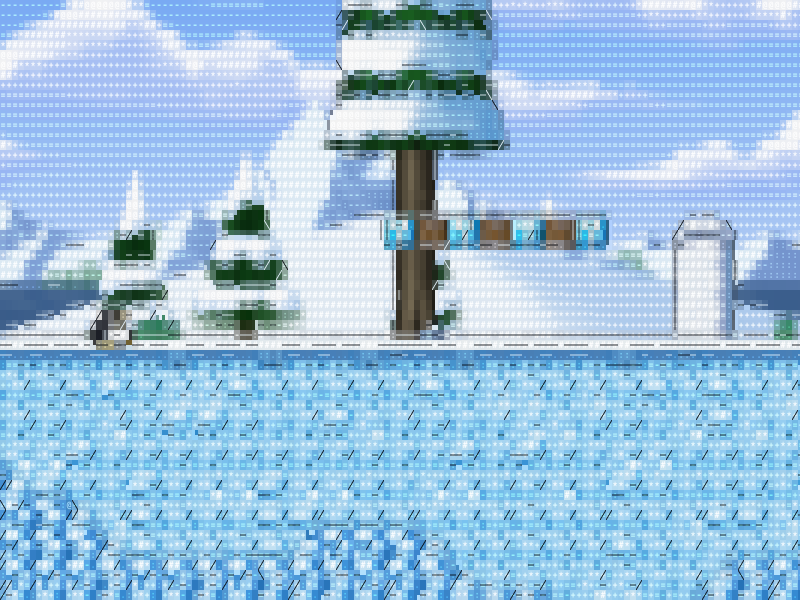
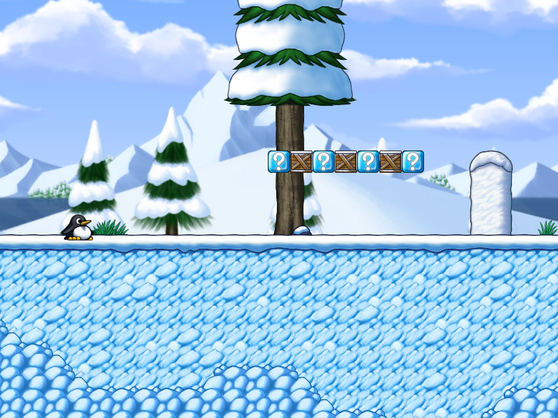
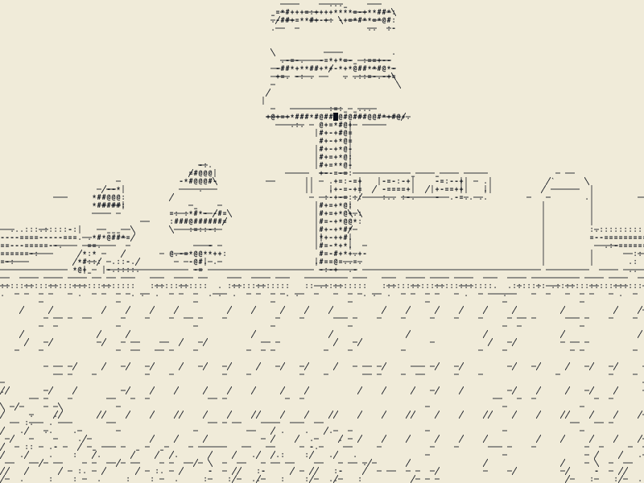

# GlyphShift

> Give your games a character of their own.

GlyphShift turns offline games and graphics applications into live ASCII and
glyph art on Linux. Mix characters, solid blocks and directional contours,
choose your palette, and shape the result while the application is running.
An in-game editor lets you experiment and save a different style for each game.



*Shape-aware illustrated color preset applied by the GPU shader to a captured SuperTux
frame. The [live editor capture](docs/shape-live-editor.png) shows the
effect running in the game through Proton.*

## Make it your own

- **Two rendering styles:** classic luminance-based glyphs, or illustrated
  rendering with separate surface fill and directional contours.
- **Local shape matching:** select glyphs by the light/dark arrangement inside
  a cell to retain small silhouettes, with scene-colored paper to avoid black gaps.
  Add outline characters such as `/\|_()^` to draw edges with text, used only
  where they actually fit the scene.
- **Your characters and fonts:** ASCII, alphanumeric, binary, blocks, Braille,
  or up to 256 custom Unicode characters, with local TTF/OTF fonts. Characters
  keep their typographic position (`_` on the floor, `'` at the top) and an
  adjustable stroke weight.
- **Live art direction:** independent cell dimensions, source color or
  monochrome, ink and paper colors, exposure, contrast, gamma and contour controls.
- **Adjustable intensity:** blend scene detail with glyphs or use strength 1
  for a drawing composed entirely of glyphs.
- **Per-game presets:** name, save and switch styles from the overlay.
- **OpenGL and Vulkan:** GPU rendering with the same controls on both backends,
  including the tested offline Proton/DXVK setup.

| Original frame | Ink on paper |
| --- | --- |
|  |  |

These are comparisons of the same captured frame using the actual GPU renderer.
More styles: [classic ASCII](docs/illustration-classic.png),
[illustrated color](docs/shape-color.png),
[coarser blocks](docs/illustration-blocks.png).

## Build from source

GlyphShift currently targets **Linux x86-64 with an X11 desktop**, windowed or
borderless applications, and an OpenGL 3.3 / Vulkan 1.0 capable driver.
It is under active development; compatibility is verified for specific
applications rather than all Linux games.

You need a C++20 compiler with floating-point `std::from_chars`, CMake 3.20+,
Ninja, Python 3, Git, Xlib, OpenGL/GLX and Vulkan development files,
`glslangValidator`, FreeType, Fontconfig, pkg-config, libxcb and xcb-keysyms.
Install a monospace font or supply a local font for text character sets.

On Arch Linux:

```bash
sudo pacman -S --needed base-devel cmake ninja python git libx11 libglvnd \
  vulkan-headers vulkan-icd-loader glslang freetype2 fontconfig pkgconf \
  ttf-dejavu libxcb xcb-util-keysyms
```

Install the Vulkan driver matching your GPU as well. From the repository root:

```bash
cmake --preset dev
cmake --build --preset dev
```

For an optimized build, use `cmake --preset release` followed by
`cmake --build --preset release`; executables will be in `build/release`.
Builds use the vendored Dear ImGui sources and do not download dependencies.

## Try the effect

Start with the included OpenGL demo, without needing a game:

```bash
GLYPHSHIFT_CONFIG="$PWD/presets/illustrated.conf" \
  ./build/dev/glyphshift -- ./build/dev/glyphshift-glx-fixture
```

For the Vulkan demo, replace `glyphshift-glx-fixture` with
`glyphshift-vulkan-fixture`. Launch a native offline game the same way:

```bash
GLYPHSHIFT_CONFIG="$PWD/presets/illustrated.conf" \
  ./build/dev/glyphshift --profile my-game -- /path/to/game
```

Replace `/path/to/game` with its executable. Run as a regular user, without
`sudo`. If the launcher reports `refusing to launch from a process with
capabilities`, use the capability-dropping prefix shown in the
[test guide](tests/README.md#refusing-to-launch-from-a-process-with-capabilities).
That guide also contains the complete **offline SuperTux/GE-Proton command**
for the prepared local test environment; Steam is not required for that test.

| Key | Action |
| --- | --- |
| Insert | Open or close the in-game editor. |
| F10 | Toggle the effect and compare with the original scene. |
| Escape | Close the editor and return input to the application. |

The color and ink presets start with **6×10 cells and glyph strength 1** to
retain smaller objects. Try **8×12** for larger, more recognizable characters.
Open **Illustration** to adjust fill, contours and tone. Larger cells make individual
characters easier to recognize; 4×4 cells cannot preserve every letter's shape.
Use **Characters and font** to change the fill set, then **Apply characters**.
Use **Save preset** to retain your applied settings.

## Choose a starting style

Try the [ready-to-use style collection](presets/README.md): Newsprint, Green
terminal, Blueprint, Amber Braille, Mosaic and Soft color. The gallery compares
all six on the same scene and explains how to switch them live without restarting.
They are available directly under **Insert → Preset → Included styles**. Choose
one to apply it immediately; personal presets remain under **Saved presets**.
No config-file copying is needed. Restart through the rebuilt launcher once to
load this version of the overlay.

Change the `GLYPHSHIFT_CONFIG` path in the launch command:

| Preset | Look |
| --- | --- |
| [illustrated.conf](presets/illustrated.conf) | Colored shading, local shape matching and scene-colored paper; 6×10. |
| [illustrated-blocks.conf](presets/illustrated-blocks.conf) | Coarser text and blocks; 10×14. |
| [illustrated-ink.conf](presets/illustrated-ink.conf) | Sparse dark ink on warm paper, with local silhouette matching; 6×10. |
| [readable.conf](presets/readable.conf) | Editable classic renderer preset for experimenting with scene/glyph blending. |
| [classic.conf](presets/classic.conf) | Pure monochrome with the original glyph ramp. |

Illustrated rendering is opt-in. Launching without an illustrated config keeps
the classic renderer unless a saved preset selects otherwise.
You can also enable **Illustration → Illustrated rendering** in the editor;
this preserves the other current settings.

To customize a file without changing a tracked preset:

```bash
cp presets/illustrated.conf /tmp/glyphshift-my-style.conf
GLYPHSHIFT_CONFIG=/tmp/glyphshift-my-style.conf \
  ./build/dev/glyphshift -- ./build/dev/glyphshift-glx-fixture
```

Edit and save that file to apply changes live. The editor never overwrites it.
Named presets are stored under
`$XDG_CONFIG_HOME/glyphshift/profiles/PROFILE/`, or
`~/.config/glyphshift/profiles/PROFILE/` by default. A config supplied through
`GLYPHSHIFT_CONFIG` takes precedence at startup and whenever that file changes;
unset it when testing restoration of a saved preset. Use `--profile` to keep
styles separate for games sharing a runtime such as Proton.

## Compatibility

GlyphShift affects only the application launched through it and its children.
The launcher enables the GLX module and Vulkan layer for that run, without a
system-wide installation. Keep the executable, shared libraries and `layers/`
directory together in the build tree.

Verified applications include the native GLX/Vulkan fixtures, glxgears,
vkcube, and offline SuperTux 0.7.0 for Windows through GE-Proton/DXVK, including
the editor in those tested setups. Hardware validation used NVIDIA on X11;
Mesa llvmpipe GLX was also tested. AMD/Intel hardware, Mesa Vulkan and arbitrary
Proton games are not established by those results.

Native Wayland input, EGL, Steam integration, exclusive fullscreen and HDR are
not currently supported. The tool is intended for **offline games and local
graphics applications**; online games and anti-cheat are outside its scope.
The launcher refuses privileged processes and targets. Full glyph rendering
can lose fine HUD/text detail, and temporal stabilization is still pending.

## Development and documentation

- [Test guide](tests/README.md): manual demos, offline SuperTux, troubleshooting
  and automated graphics tests.
- [Implementation and TODOs](docs/implementation/README.md): architecture,
  remaining work, milestone acceptance criteria and recorded validation results.
- [Repository instructions](AGENTS.md): guidance for implementation agents.

Run the CPU and integration checks that do not require a display with:

```bash
ctest --preset dev
```

For development tooling, `cmake --preset dev` generates
`build/dev/compile_commands.json` and a root symlink for your LSP. Formatting
inherits Google style with four-space indentation and a 100-column limit.
Install `clang-format`, then activate the pre-commit check:

```bash
git config --local core.hooksPath .githooks
python3 tools/format.py --check
```

Use `python3 tools/format.py --apply` to format project C/C++ files. Vendored
sources are excluded. Before proposing a change, consult the implementation
reference for the relevant scope and validation requirements.
