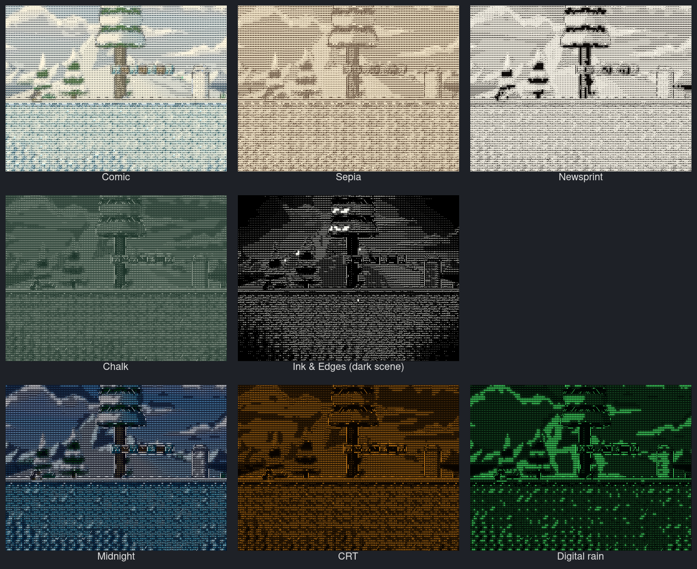
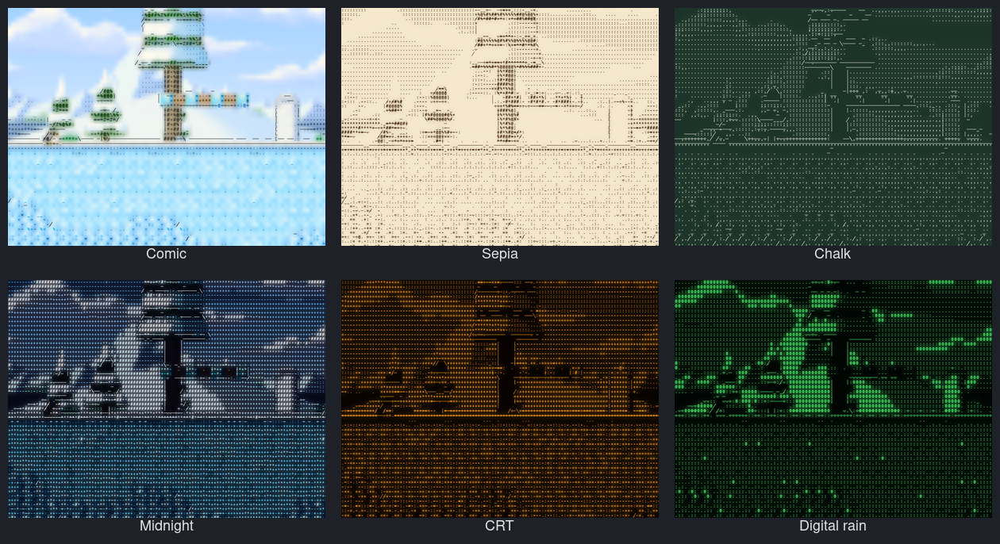

# Ready-to-use styles

Run commands from the repository root. These configs work with the current
illustrated renderer; no additional fonts or downloads are needed beyond the
project's normal monospace font requirement.

| Config | Style | Cell size | Glyph strength | Preview |
| --- | --- | --- | --- | --- |
| [art-soft-color.conf](art-soft-color.conf) | Gentle color treatment with original detail blended in; start here for gameplay. | 6×10 | 0.65 | [Image](../docs/presets/art-soft-color.png) |
| [art-newsprint.conf](art-newsprint.conf) | Black ink, warm white paper, letter shading and ASCII outline silhouettes. | 8×12 | 1 | [Image](../docs/presets/art-newsprint.png) |
| [art-green-terminal.conf](art-green-terminal.conf) | Green terminal letters with ASCII outline silhouettes on a dark background. | 8×12 | 1 | [Image](../docs/presets/art-green-terminal.png) |
| [art-blueprint.conf](art-blueprint.conf) | Cyan directional outlines on navy paper, with surface fill disabled. | 6×10 | 1 | [Image](../docs/presets/art-blueprint.png) |
| [art-amber-braille.conf](art-amber-braille.conf) | Amber Braille dots on dark paper; deliberately dense and textured. | 6×10 | 1 | [Image](../docs/presets/art-amber-braille.png) |
| [art-mosaic.conf](art-mosaic.conf) | Source-colored quadrant blocks for a geometric pixel mosaic. | 8×12 | 1 | [Image](../docs/presets/art-mosaic.png) |



These are GPU previews of the same [captured frame](../docs/illustration-original.png),
not six new live gameplay tests. Except for Soft color, the styles use strength 1:
all visible detail comes from cell palettes and glyph masks. Blueprint deliberately
omits most surface detail; Mosaic deliberately uses blocks instead of letters.

## More styles

Six more configs use the newer ink, paper wash, glow and outline-glyph controls.
They are config files only: load them with `GLYPHSHIFT_CONFIG` (below), then
**Save preset** to keep one in the overlay's **Saved presets**.

| Config | Style | Cell size |
| --- | --- | --- |
| [art-comic.conf](art-comic.conf) | Bold scene-colored inks over a vivid watercolor wash. | 8×12 |
| [art-sepia.conf](art-sepia.conf) | Sepia pen etching on cream paper with a soft ink bleed. | 7×11 |
| [art-chalk.conf](art-chalk.conf) | Chalk drawing on a dark green board. | 8×12 |
| [art-midnight.conf](art-midnight.conf) | Classic terminal ASCII in saturated scene colors on a near-black sky. | 7×11 |
| [art-crt.conf](art-crt.conf) | Amber CRT phosphor letters with a warm glow. | 7×12 |
| [art-digital-rain.conf](art-digital-rain.conf) | Glowing green binary digits on black. | 8×12 |



Like the gallery above, these are GPU previews of the same captured frame, not
live gameplay tests. Dark-paper styles (Chalk, Midnight, CRT, Digital rain)
use low exposure so a bright scene does not fill the screen with characters;
raise **Exposure** for darker games.

```bash
cp presets/art-comic.conf /tmp/glyphshift-style.conf
setpriv --inh-caps=-all --ambient-caps=-all -- \
  env GLYPHSHIFT_CONFIG=/tmp/glyphshift-style.conf \
  ./build/dev/glyphshift -- ./build/dev/glyphshift-glx-fixture
# In a second terminal, switch live:
cp presets/art-sepia.conf /tmp/glyphshift-style.conf
```

## Choose directly in the overlay

Restart the application through the rebuilt launcher to load the updated shared
libraries. Press **Insert**, open **Preset**, and choose any of the six names
under **Included styles**. The running scene updates immediately; hover a name
for a short description. Your own saved presets appear under **Saved presets**.
No file copying or additional installation is required.

The included styles are embedded from these configs at build time, so they also
work when launching outside the checkout. After editing a shipped `.conf`,
rebuild to update its included version; an external live config still reloads
directly from disk.

To retain edits, use the suggested `art-STYLE-copy` name or type another name,
then click **Save preset**. Saving creates a per-game copy and leaves the source
config unchanged. If you explicitly save under an included style's exact ID,
that per-game file takes precedence over the included version for that profile.

The selected name is remembered per profile. To restore it on the next launch,
omit `GLYPHSHIFT_CONFIG` and `--preset`: explicit startup overrides take
precedence. Selecting another style in the overlay still works while an external
config is set; editing that external file reapplies its settings.

## Load a config from the command line

For the native demo:

```bash
setpriv --inh-caps=-all --ambient-caps=-all -- \
  env GLYPHSHIFT_CONFIG="$PWD/presets/art-newsprint.conf" \
  ./build/dev/glyphshift -- ./build/dev/glyphshift-glx-fixture
```

For SuperTux, use the complete [offline launch command](../tests/README.md#windows-supertux-through-ge-proton-without-steam)
and change its `GLYPHSHIFT_CONFIG` path to the selected config above.
Keep the offline wrapper and other Proton arguments from that command.
Press **F10** to compare with the original scene and **Insert** to adjust the style.

## Switch styles without restarting

First prepare one live config:

```bash
cp presets/art-soft-color.conf /tmp/glyphshift-style.conf
```

Launch the demo using that file:

```bash
setpriv --inh-caps=-all --ambient-caps=-all -- \
  env GLYPHSHIFT_CONFIG=/tmp/glyphshift-style.conf \
  ./build/dev/glyphshift -- ./build/dev/glyphshift-glx-fixture
```

For SuperTux, set `GLYPHSHIFT_CONFIG=/tmp/glyphshift-style.conf` in its complete
launch command instead. Once the application is running, copy another style
onto the same live file from a second terminal:

```bash
cp presets/art-newsprint.conf /tmp/glyphshift-style.conf
cp presets/art-green-terminal.conf /tmp/glyphshift-style.conf
cp presets/art-mosaic.conf /tmp/glyphshift-style.conf
```

Run one copy command at a time and inspect the result. GlyphShift reloads the
file automatically; the tracked presets stay unchanged. This switches settings,
so it does not require a rebuild or application restart if the current libraries
are already loaded.

The included styles can also be selected at startup with `--preset`, for example:

```bash
./build/dev/glyphshift --preset art-newsprint -- ./build/dev/glyphshift-glx-fixture
```

This uses the same embedded style that appears in the overlay. Omit the explicit
startup overrides to resume your last selected preset for the same profile.

The existing [illustrated](illustrated.conf), [ink](illustrated-ink.conf), and
[coarse blocks](illustrated-blocks.conf) configs remain available too.
